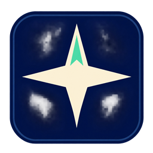

  

<h1 align="center">Teyvat Companion · Android</h1>

A Genshin Impact chest compass for Android. Find a target from the minimap,
confirm chest openings automatically when recognised, and sync progress with HoYoLAB.

[Download the Android preview](../../releases) · [Build and test](docs/BUILD.md) · [Українська інструкція](docs/QUICKSTART_UK.md) · [Privacy](PRIVACY.md)

## Get started

1. Install the Android ARM64 preview APK. It targets Android 10 or newer. The
   minimap layout was calibrated on a Galaxy S25 Ultra.
2. Open Teyvat Companion and allow the compass to appear over other apps.
   Tap **Start navigation**. Choose Genshin Impact in Android’s screen-sharing picker when offered.
3. Play in landscape with the minimap visible. Briefly open the game map if the app needs help locating you.
4. Open the target chest. The app saves recognised openings and moves on. Tap **✓** next to the compass for manual confirmation.

After playing, tap **Sync with HoYoLAB** once and sign in on the official map
inside the app. Navigation stops and the map processes the queued changes
while its screen stays open. The status line reports when the queue is clear.

English is the default language. Settings also offers Ukrainian and Russian.
This preview covers surface chests on the main map and shows approximate
horizontal distance. Devices with a different game HUD may require calibration.

## Documentation

- [Build and test](docs/BUILD.md)
- [Data and privacy](PRIVACY.md)
- [Security reporting](SECURITY.md)
- [License](LICENSE) and [third-party notices](THIRD_PARTY_NOTICES.md)

Teyvat Companion is an independent project. Genshin Impact and HoYoLAB are HoYoverse products. The Windows edition has its own `teyvat-companion-windows` repository.
